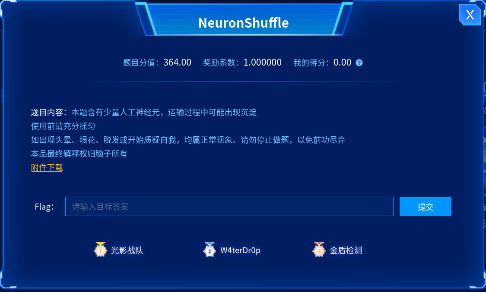
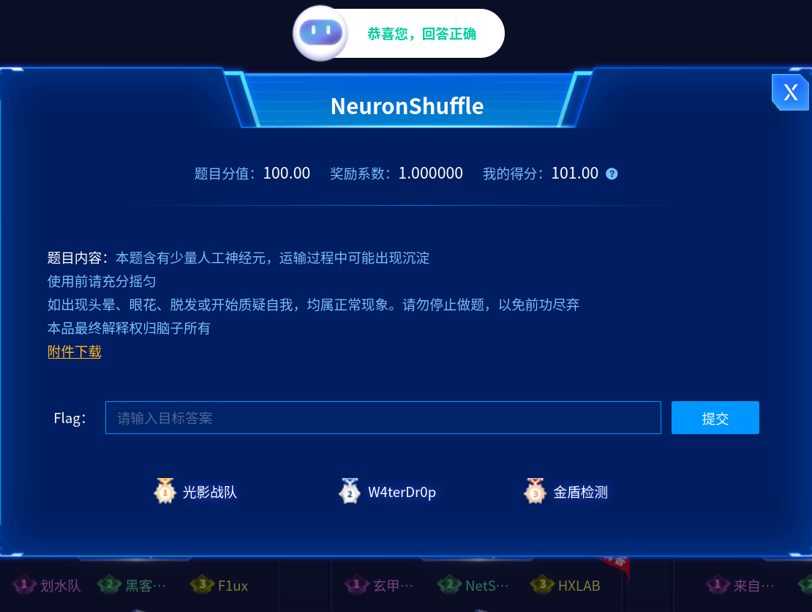
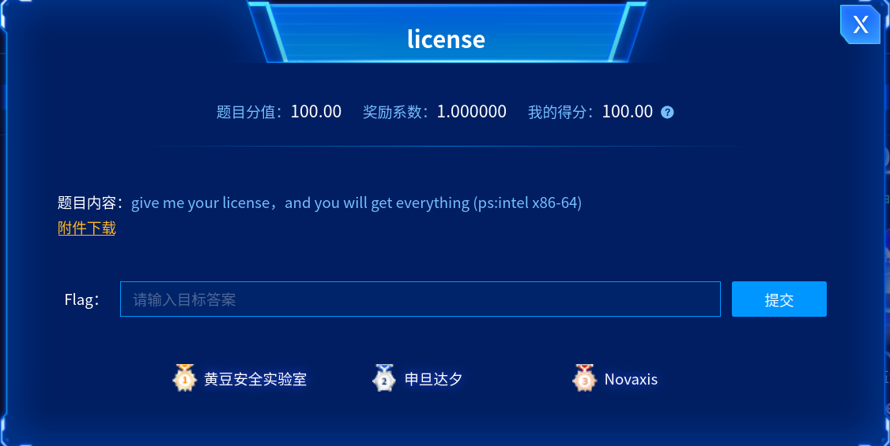
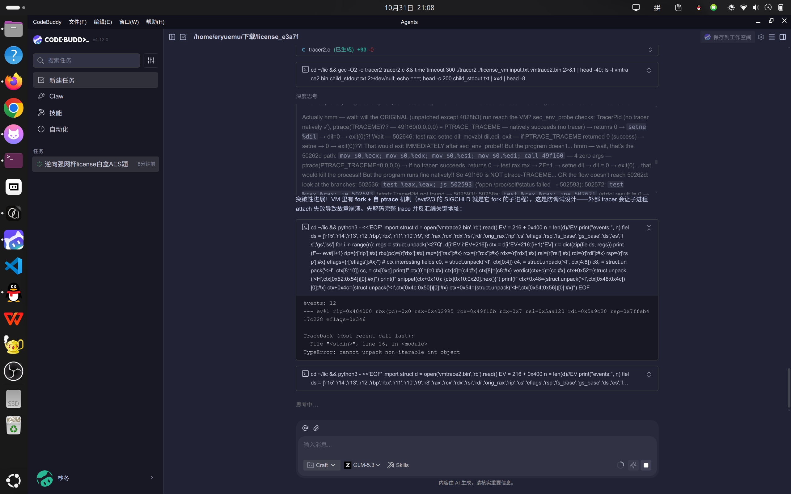

# 强网杯NeuronShuffle与license预期解WP

> **背景**：这算是我第一次参加 CTF 比赛。2026 强网杯线上赛，我不是队里主力，方向也没定，就挑了两道看起来能自己啃的题：misc 的 NeuronShuffle 和 reverse 的 license。
> **工具**：CodeBuddy、Qoder、Trae、DSH（DeepSeek Harness）四个 AI 工具接力，中间还参考过另一个 AI 给的建议。
> **结果**：两道题都拿到了 flag，而且都在真程序 / 本地校验器上复验过。
> **本文定位**：按真实时间线写解题过程和踩过的坑。技术细节保留到能照着复现的程度，但不搬 15MB 反汇编和 187 个中间文件。

---

## 0. 先看结果

| 题目 | 方向 | 一句话 | flag |
|---|---|---|---|
| NeuronShuffle | misc | 模型是 `default_rng(20261101)` 摇出来的，答案却是 `default_rng(20261102)` 摇的三个排列 | `flag{5c2aabdc937513bde1ba502f14cc51b6}` |
| license | reverse | 白盒 AES 是诱饵，真正的判定在自修改 VM 里，最后靠逐字符枚举补完 | `flag{9530b81c-61d0-2b62-3e96-f9a5e937f893}` |

时间线（本地时间，2026-10-31 到 11-01）：

| 时间 | 工具 | 做的事 |
|---|---|---|
| 10-31 12:49–15:42 | Qoder | NeuronShuffle：拆模型、发现 σ=0.6、扫出种子 20261101、复原生成器 |
| 10-31 15:44–19:27 | Trae | NeuronShuffle：GPU 爆破、battery12、验证队友给的答案方向、拿到 flag |
| 10-31 20:02–21:17 | CodeBuddy | license：第一轮白盒分析、发现 VM、导出 118 条会话记录 |
| 10-31 21:18–23:30 | Qoder | license：推翻「白盒是 PRF」、零侵入采样、破 VM 密钥流、写交接文档 v1 |
| 10-31 23:34–11-01 09:41 | DSH | license：完整仿真器、哈希反演、解出前 24 字节和第二段前 7 字节 |
| 11-01 10:55–11:18 | Qoder | license：补 LOOP 指令、逐字符搜索、真机打印 flag |

从 10-31 12:49 到 11-01 11:18，大约 22 个半小时。中间隔了一次宿舍熄灯和一次「我这电量大概还能一个小时」。

---

## 一、NeuronShuffle：答案不在模型里

### 1.1 题目：一个哈希，两个 npz



附件三个文件：`check.py`、`model_A.npz`、`model_B.bin`。`check.py` 是唯一的判据：

```python
V = "cf8303ef7e9fc6f51baf27b6e2c8763bd199a0a24c5294bcdaca3ddef6e47864"

def main():
    if len(sys.argv) != 2:
        sys.exit(__doc__)
    src = Path(sys.argv[1])
    try:
        text = src.read_text() if src.exists() else sys.argv[1]
    except OSError:
        text = sys.argv[1]
    try:
        canon = ";".join(",".join(str(int(v)) for v in s.split(","))
                         for s in text.strip().split(";"))
    except Exception:
        sys.exit("[-] wrong")
    body = hashlib.sha256(canon.encode()).hexdigest()[:32]
    if hashlib.sha256(("ns::" + body).encode()).hexdigest() == V:
        print(f"[+] correct! flag = flag{{{body}}}")
    else:
        sys.exit("[-] wrong")
```

几个关键点：

- 答案是**一个字符串**，`;` 分组，`,` 分隔组内整数。
- `int()` 允许空格、前导零、正负号，所以格式不影响哈希，**只有整数序列有意义**。
- 命中后 flag 就是 `sha256(canon)[:32]`，外面再包一层 `flag{}`。
- 注释里的 usage 是三个组 `i0,i1,...;j0,...;k0,...`，但示例不一定等于真实分组。

也就是说，这题没有「验证逻辑」可逆，只有一个哈希。要么猜中答案串，要么把出题人的生成过程整个复原。

### 1.2 第一晚：把模型拆成 32→48→40→32→16

`model_A.npz` 有 8 个数组：`k0,k1,k2,k3,k4,k5,k6,k7`。第一眼看像乱序权重，把形状摆出来就清楚了：

```
32 → 48 → 40 → 32 → 16
```

`k5/k3` 是第一层权重/偏置，`k2/k4` 第二层，`k6/k7` 第三层，`k1/k0` 输出层。

更有意思的是矩阵的重复结构：

| 矩阵 | 行数 | 不同行 | 列数 | 不同列 |
|---|---|---|---|---|
| k5 | 48 | 14 | 32 | 32 |
| k2 | 40 | 12 | 48 | 13 |
| k6 | 32 | 10 | 40 | 11 |
| k1 | 16 | 16 | 32 | 10 |

每层只有 14 / 12 / 10 个「真神经元」，其余都是精确复制出来的副本，散落在各层的位置里。题面那句「本题含有少量人工神经元」说的就是这个。

继续看，每个神经元可以用一对 `(入权重类, 出权重类)` 唯一标识，三层 48 / 40 / 32 个组合全部互不相同。到这一步，模型的结构已经完全清楚，接下来自然是「把这些类还原成出题人的顺序，拼成答案」。

这条路走了很久，但方向是错的。

### 1.3 卡点：知道结构，不知道答案长什么样

第一晚把能想到的序列化形式几乎试了一遍：行类/列类分组、层序全排列、0/1 基、成员表、代表元、副本映射、类编号、类大小、坐标、单元号、npz 内部顺序、全局偏移、`np.unique` 的各种输出、argsort、首现序、cell-rank……

累计排除了二十多万条候选，一条没中。

当时的判断是「答案一定是这些标签的某种序列化，只是形式没猜对」。这个判断后来被证明是错的，但在当时它很合理：所有证据都指向标签结构，而且题面反复在说「摇匀」「沉淀」。

### 1.4 转折：σ=0.6，之前所有种子搜索都白跑了

第二晚换了个切入点：这些浮点数不像是训练出来的权重，更像是某个固定种子生成的高斯随机数。如果能把种子找回来，就能重放生成过程，拿到出题人脚本里的原始变量。

一开始的搜索是「精确值集合匹配」：拿观测到的 926 个唯一值，去 RNG 流里找同样的集合。扫了很久没有结果。

问题出在一个隐含假设上：**之前的搜索都默认 σ=1**。但实测标准差是 0.6029，不是 1。只要作者写的是 `rng.normal(0, 0.6, ...)`，精确值匹配就永远不可能命中。

改成尺度无关的检验：把观测值和流值各自排序，逐项求比值。如果它们来自同一条流、只是乘了一个常数，这个比值应当恒定，常数就是 σ。

```python
obs = np.sort(np.abs(table).ravel())
stream = np.sort(np.abs(rng.normal(0, 1, obs.size)))
ratio = obs / stream
# ratio 近似常数 => 同一条流，sigma = median(ratio)
```

这个检验还有个小坑：对小表不能拿「流里最小的 n 个」去比，必须拿「流的前 n 个」排序后再比。第一版检验器就是在这里错的，导致 156 个值的 k2 永远匹配不上。

修好之后，32 位种子空间铺满 32 核开扫。`default_rng` 每个种子只要 20 微秒，扫到 `20261101` 只用了十几分钟——这个数字本身就是提示：2026-11-01，比赛日期。

### 1.5 生成器复原：974 个高斯 + 三次「摇匀」

种子确定后，剩下的就是逐位重建。作者用了 `np.random.default_rng(20261101)`，`normal(0, 0.6)`，抽取顺序如下：

```python
rng = np.random.default_rng(20261101)
SIG = 0.6

T5    = rng.normal(0, SIG, (14, 32))   # k5 的表，14 行 x 32 输入
b3    = rng.normal(0, SIG, 14)         # k3（L1 偏置）
T2blk = rng.normal(0, SIG, (12, 14))   # k2 的表，12 行 x 14 列
b4    = rng.normal(0, SIG, 12)         # k4（L2 偏置）
T6blk = rng.normal(0, SIG, (12, 12))   # k6 的表，12 行 x 12 列
b7raw = rng.normal(0, SIG, 12)         # k7（L3 偏置）
T1    = rng.normal(0, SIG, (16, 10))   # k1 的表，16 输出 x 10 列
b0    = rng.normal(0, SIG, 16)         # k0（L4 偏置）
```

一共 974 个高斯抽取。真正有意思的是后面的类分配：

```python
def assign(rng, RP, RQ, n):
    while True:
        P = rng.integers(0, RP, n)
        Q = rng.integers(0, RQ, n)
        if len(set(zip(map(int, P), map(int, Q)))) == n:
            return P, Q

P1, Q1 = assign(rng, 14, 14, 48)   # 摇了 584 次
P2, Q2 = assign(rng, 12, 12, 40)   # 摇了 525 次
P3, Q3 = assign(rng, 12, 10, 32)   # 摇了 102 次
```

每次同时抽 `P` 和 `Q`，如果存在重复的 `(P,Q)` 对就整轮重来，直到所有对唯一。这就是题面「使用前请充分摇匀」的真实机制——不是比喻，是真的在拒绝重采样。

而「沉淀」也有了对应的东西：有些类一个神经元都没分到。

| 层 | 网格 | 空类（沉淀） |
|---|---|---|
| L1 | 14 × 14 | Q1 的类 1 |
| L2 | 12 × 12 | Q2 的类 9 |
| L3 | 12 × 10 | P3 的类 1 和 5 |

这些类的表值永远不会出现在模型里，正好解释了流里那些「缺失」的高斯值。

重建代码跑完，输出：

```
L1 match: True tries: 584
L2 match: True tries: 525
L3 (12x10) match: True tries: 102
```

8 个数组逐位精确，一个比特都不差。

题面到这一步全部对上了：

| 题面 | 机制 |
|---|---|
| 本题含有少量人工神经元 | 每层只有 14 / 12 / 10 个不同神经元，其余是精确副本 |
| 运输过程中可能出现沉淀 | 有些 `(P,Q)` 类没分到神经元，对应表值永远不出现 |
| 使用前请充分摇匀 | 类分配用拒绝重试循环，直到所有 `(P,Q)` 对唯一 |
| 最终解释权归脑子所有 | 答案和这套标签结构没有关系 |

### 1.6 最后一层纸：20261102 的三个 permutation

生成器复原之后，我仍然在「标签怎么序列化」里打转。Trae 那边写了一个 OpenCL 的 GPU 爆破器，把短答案、排列组合、单整数之类的空间扫了约 4.4 万亿条，速率 1.2 G/s，队列按 15 个小时排。

那天晚上宿舍 23:40 熄灯，所以队列先改成 setsid 脱离终端，后来又切回 Trae 的托管模式——它自带「跑完 / 命中就通知」的功能，人不用守着。但队列没跑完，最后是队友给出答案之后直接停掉的，这些算力全部是白跑。

真正把这题结束掉的不是 GPU，是交接文档。我把那份写满「已确认 / 已排除 / 当前卡点」的文档发给了队友，队友基于它独立做出来了，把答案串回传给我；我这边用 battery12 复现了「次日种子 + 三个 permutation」的生成方式，再用 `check.py` 验过。

答案不是模型的标签结构，而是作者用**次日种子**重新摇的三个排列。

```python
rng = np.random.default_rng(20261102)   # 模型种子 20261101 + 1
p1 = rng.permutation(48)                # 第一层 48 个神经元
p2 = rng.permutation(40)                # 第二层 40 个神经元
p3 = rng.permutation(32)                # 第三层 32 个神经元

canon = ";".join(",".join(map(str, p)) for p in (p1, p2, p3))
```

三个组，长度 48 / 40 / 32，0 基、正序、恒等组序，用 `;` 连接，总共 329 个字符。验证：

```bash
$ python3 check.py "$(cat answer.txt)"
[+] correct! flag = flag{5c2aabdc937513bde1ba502f14cc51b6}
```

「充分摇匀」在这里有第二层意思：`permutation` 本身就是 shuffle。模型里的拒绝重试是「摇匀」，答案里的三个排列也是「摇匀」，只是后者和模型结构完全无关。

这也解释了为什么之前所有标签序列化都失败：**答案根本不在模型里**。模型只是用来藏种子的。种子 20261101 指向比赛日期，答案种子 20261102 是它的下一天，这个「+1」几乎不需要猜——先试相邻日期，第一个就中。



### 1.7 这题踩的坑

| 坑 | 后果 | 怎么发现的 |
|---|---|---|
| 默认 σ=1 做精确值匹配 | 前面所有种子搜索全部无效 | 实测 std=0.6029，改成尺度无关比值检验 |
| 检验器把小表比成「流里最小的 n 个」 | k2/k6 这类小表永远匹配不上 | 造已知种子的合成样本自测 |
| 把 `model_B.bin` 当线索 | 浪费大量算力在 44982 字节噪声上 | 熵 7.9966、无重复块、与原 RNG 任何续流都不匹配 |
| 相信「把 B 送进模型做前向推理」 | 输出全是溢出/NaN/乱码 | 模型是随机初始化，且 44982 不能被 32/4/8 整除 |
| 锚定「答案一定是标签序列化」 | 二十多万条候选 + GPU 4.4 万亿条全部白跑 | 把交接文档发给队友，队友换假设，直接试次日种子的 permutation |
| GPU 队列按「小时」排 | 熄灯前跑不完，最后也没命中 | 先 setsid 脱离终端，后切回 Trae 托管（自带完成通知）；破局靠把交接文档发给队友 |

最贵的一条是最后那个：**证据越多，越容易把错误假设当成前提**。模型结构、标签映射、沉淀位置都是真的，但它们只说明「模型是怎么生成的」，不说明「答案是什么」。

---

## 二、license：白盒是幌子，VM 才是判官

### 2.1 入口：96 个 hex，48 字节



程序是静态链接的 x86-64 ELF，1,747,992 字节，not stripped，非 PIE。跑起来：

```
please input your license:
```

输入 96 个大写 hex 字符，也就是 48 字节。错了打印 `Rejected.`，对了打印 flag。

调用链大致是：

```
main 0x402f9a
 ├ sec_env_probe 0x5024fc          反调试
 ├ wb_stream_emit 0x502825         提示文本
 ├ wb_read_line                    读一行
 ├ chow_wb_encrypt 0x50299e        白盒 AES（48 字节）
 ├ wb_verify_fold 0x502e9f         OR-fold(out ^ wb_tgt)，算完直接丢弃
 └ 0x402e5b                        清零 ctx、装信号处理器、进 VM
```

第一轮分析花了很久在白盒 AES 上，后来发现方向错了：`wb_verify_fold` 把 48 字节输出和目标 `wb_tgt` 逐字节异或，再把所有结果 OR 起来，得到一个 `mismatch`。但这个值**只用来算一个 LCG 种子**，而它影响的 `session_state` 在 `build_ctx` 里只参与 `((x*x)^x)&1`——这个式子恒等于 0。

也就是说，白盒校验对 VM 没有任何影响。真正的判定全在 VM 里。

### 2.2 白盒 AES 第一轮：一个采样假象

第一轮最有价值的不是「白盒怎么逆」，而是推翻了一个错误结论。

队友做过一个碰撞实验：对每个 (轮, 列) 随机抽 20 万组四字节，测到约 4.5 次碰撞/映射，于是判断「非单射 ⇒ 白盒是 PRF，license 不可逆」。

这个结论是采样本身造成的：20 万组四字节落进 2³² 的空间，期望碰撞数大约是

```
200000² / 2³³ ≈ 4.7
```

量级和观测到的 4.5 完全吻合。重复抽到同一组四元组，当然会「碰撞」。

直接对表做代数检查，结论相反：

- `wb_tt` 的 256 个 T 盒，每个的差分像 `{T[b] ^ T[0]}` 恰好是 GF(2) 上 8 维子空间，255 个非零差分互不相同；
- 任意 4 个连续 T 盒的像空间之和维数是 32，是直和；
- 直和 ⇒ `(b0,b1,b2,b3) ↦ ⊕T_k[b_k]` 是双射。

所以每一轮都是 16 字节上的置换，整个 chow 可逆。`roundmodel.py` 对真机 48 组状态验证，48/48 全对。

但这仍然救不了这题——白盒是诱饵，逆出来也没用。真正有用的是「置换」这个结论带来的信心：license 是可求的。

### 2.3 gdb 为什么一定跑飞

第一轮试过 gdb 和 ptrace，全部跑飞。原因不是权限，是程序的信号处理器：

```
0x406000: cmpq $2, 0x8(%rsi)    ; si_code == TRAP_TRACE ?
```

正常单步陷阱的 `si_code` 是 2。ptrace 重新注入的 SIGTRAP 不是 2，于是走反调试分支：把 `ctx+0xc` 置 1，重新设 TF，跳回解释器。`ctx+0xc` 是密钥流的输入之一，改了它，字节码就解成垃圾。

还有一层：VM 的 init 会算两个自校验哈希。

| ctx 偏移 | 来源 | 干净运行的真值 |
|---|---|---|
| `+0x4c` | 内存 `[0x404000, 0x407f00)` 的 `*31` 哈希 | `0x289c99f8` |
| `+0x218` | 文件 `[0x401000, 0x5022e0)` 的 `*31` 哈希 | `0` |

所以：

- 改 `.text` 任何一个字节 → `0x218` 变 → 字节码解错；
- 改解释器/handler 窗口 → `0x4c` 变；
- 用 gdb 附加 → `TracerPid` 变，`0x48` 也跟着变。

程序把「不许调试、不许打补丁」写进了密钥流。



### 2.4 零侵入采样：父进程读 `/proc/<pid>/mem`

不能 ptrace，不能打补丁，但可以从父进程读 `/proc/<pid>/mem`。父进程的 `pread` 不算 ptrace，`TracerPid` 保持 0，`si_code` 保持 2，VM 原生运行。

`snoop.py` 的流程：

1. `fork` + `execv` 启动程序；
2. 轮询 `pread(fd, 6, 0x402f9a)`，等到返回 `f3 0f 1e fa 55 53`（`endbr64; push rbp; push rbx`）再打开 `/proc/<pid>/mem`——**必须等 exec 完成**，否则 fd 绑到的是 Python 自己的地址空间；
3. 写入 97 字节输入（96 hex + 换行），**不要关管道写端**；
4. 每轮读 `0x240` 字节的 ctx（`0x5aa360`），当 `*(u64)(ctx+0x28) == 0x505260` 时，额外读 `0xa00` 字节的运行时表（`0x5a9c00`）。

拿到的东西：

- 错 license 的 `c1` 采样：1236 次 dispatch、1971 个不同的 ctx 快照；
- 正确 license：2759 次 dispatch，比错的多跑了 1500 多步。

解析时有个坑：同一个 `ic` 可能有多条快照（解释器中途、phase A、phase B），`ctx+4` 会滞后一步。要按 `ic` 分组，不能把「第一条」当唯一真值。

### 2.5 哈希反演：3 个 8 字节 Feistel

VM 真正校验的是 license 前 24 字节的哈希。数据流是：

```
license[0:24] → ctx+0x90..0xa7
3 轮 Feistel，状态拆成 3 个独立的 8 字节子系统
每轮：G_i: 4 字节块 → 0xb4..0xbf 的输出块（SBOX + 线性组合 + XOR）
      R_i: (A,B) → (B, A ^ G_i(B))
s1 = R1(s0), s2 = R2(s1), s3 = R3(s2)
ctx+0x90..0xa7 ^= license
Y = s3 ^ s0
ctx+0xa8..0xbf ^= ctx+0x90..0xa7
A = X ^ Y，其中 X = FIN(Y)
```

`FIN` 是纯线性的：24 个 XOR 方程，没有 SBOX，可以写成 192×192 的 GF(2) 矩阵求逆。

目标是 `T = ctx+0xc0 ^ ctx+0x200`，这两个值来自 `build_ctx` 的 rand 表，确定性：

```
T = 082f54e63c2997605d0679ba143a49d07dcdba76266c79d0
Y = FIN⁻¹(T) = 8721a19db336fdb91f3f6f5b9a2adcdc0b53034b6a8a0324
```

有一个决定性的交叉验证：`A0 = X[0] ^ Y[0] = 0x8f`，正好等于独立枚举出的唯一连贯尾路径的 `b`。1/256 的巧合，基本排除了运气。

### 2.6 解出前 24 字节

每个子系统的 `G_i` 直接项恰好是恒等映射，所以 `g_i(b) = b ^ G_i(b)` 是纯 SBOX 组合，`g1inv` 可以解析反解：先逆线性层 `so`，再逆 SBOX，再逆 `sin`。

每个子系统 64 位方程、64 位未知，枚举 `D`（2³²）：

```c
for (uint64_t D = 0; D < (1ULL << 32); D++) {
    V  = C ^ g3(D);
    b0 = g1inv(V);
    P  = Ylo ^ D ^ G1(b0);
    if (D == (b0 ^ G2(P))) {
        a0 = Ylo ^ D;
        /* 命中 */
    }
}
```

C + OpenMP，24 线程，三个子系统一共 43 秒。

结果：

```
LICENSE24 = 5B6C94D3EB4619D34E666179A1D203EF0A3D6661271D3D05
A0 = 0x8f ✓   X == T ✓
```

拿它跑真程序：2759 步、`ctx+0xe9=0`（fold 通过）、`ctx+0x1a0` 写出 `the structure is the key`。

这里有个必须说清楚的坑：**`the structure is the key` 是提示，不是 flag**。它是 VM 在 license 通过后构造的 24 字节提示串，后面还有 24 字节要消费。当时另一个 AI 很肯定地说 flag 就是它，提交上去是错的。

### 2.7 第二段 24 字节：逐字节消费

提示文本构造完之后，程序开始按 `ctx+0x78`、`0x79`、`0x7a`…… 读 `license[24]`、`license[25]`、`license[26]`……每个字节做四件事：

```
ctx+0xa ^= license[24+k]
用字节的高 5 bit / 低 4 bit 建掩码表 ctx+0x100..0x117
更新 16 字节置换 ctx+0xe0..0xef
把 ctx+0xe0[..] 再混一次进 ctx+0xa
```

每个字节一份代码，不循环，地址递增。`ctx+0xa` 是密钥流计数器，直接决定下一条 dispatch 落点。

用「正确字节必须让程序走到读下一个字节」作为判据，前 7 个字节能唯一解出来：

```
second[0:7] = 00 80 0C C0 20 E0 01
```

第 8 个字节（`license[31]`）卡住了：span 加到 600 也没有候选能走到 `[r12+0x80]`。贪心多跑一整块会在 `#4320` 落到 `fisttp word ptr [r14]`，而 `r14 = 0`，真机必崩。

### 2.8 最后 3 小时：补 LOOP、找 tripwire

真正的破局点来自两个很底层的东西。

**第一，仿真器缺 LOOP 族指令。** `vmemu.py` 里没有 `loopne` / `loope` / `loop`，所以仿真在某个块尾停住。补上之后（`rcx--`，再判 `rcx != 0` 与 ZF），仿真能越过卡点。

**第二，`Rejected.` 不是 license 判定。** 真机的执行在 `#9170` 附近落到 `int 0x44`，触发 #GP → SIGSEGV → handler `0x4028b3` 打印 `Rejected.` 然后 `exit(0)`。也就是说，`Rejected.` 是崩溃兜底，不是「license 错了」。

flag 阶段的真实形状是：

```
每写一个字符：mov byte [r12+r15+0x1c8], al
块尾：movzx eax, byte [r12+0xNN]
      做 imul + [rdi+x+0x300] + [rsi+y*2] 哈希
      xor 进 ctx+0xa
```

读错一个字节 → 下一条 dispatch 落到 `int 0x44` → 崩溃。于是 `solveflag.py` 的做法是：锚在每次写字符之后，把块尾那个 ctx 字段的 256 个值全枚举一遍，只留「下一个 flag 字符可打印」的，逐块推进。

为了确认仿真器可信，先和零侵入快照对齐：真机 8690 个采样点里只有 9 个不匹配（都是采样落在 dispatch 中途的假阳性），真机最后一条快照 `ic=9170, ctx+4=0x28fab` 和仿真完全一致。仿真器在 `#0..#9170` 是真机等价的，才敢继续往下跑。

跑到 `#17137`，VM 正常退出。

**第三，fold 不是唯一解。** 最初的 `solve2.c` 每个子系统 `if (found) continue`，只保留第一个解。去掉早退之后：

| 子系统 | 解的个数 |
|---|---|
| j=0 | 2 |
| j=1 | 3 |
| j=2 | 1 |

license 的排布是 `j0.a0 j1.a0 j2.a0 j0.b0 j1.b0 j2.b0`。flag 阶段要求 `license[16..19] = 02 B5 FD CB`，而 j=1 的第二个解正好是 `a0=1d85e234 b0=02b5fdcb`。换掉这一对，前半就自洽了。flag 阶段不读 `license[4..7]`，所以 `a0` 一起换掉不影响后半段。

最终 license：

```
5B6C94D31D85E2344E666179A1D203EF02B5FDCB271D3D05
00800CC020E00101600C20E000800CA14040E01A038260E0
```

### 2.9 拿到 license 之后

48 字节 license 只是输入，flag 是程序打印出来的。把它写成 96 个 hex 字符的文件：

```bash
$ cat TRUE_LIC.txt
5B6C94D31D85E2344E666179A1D203EF02B5FDCB271D3D0500800CC020E00101600C20E000800CA14040E01A038260E0

$ ./license < TRUE_LIC.txt
please input your license: flag{9530b81c-61d0-2b62-3e96-f9a5e937f893}
```


提交的是 `flag{...}`，不是 license 本身。

如果手上只有仿真器，等价的做法是跑 `solveflag.py`，它会落盘 `flag_candidate.txt` 和 `license_candidate.txt`；或者跑到 `#17137` 后直接读 `ctx+0x1c8`（`0x5aa528`），flag 就在那 56 字节的缓冲里。

从 license 到 flag 的链路：

| 阶段 | 输入 | 发生什么 | 产物 |
|---|---|---|---|
| 哈希 fold | `license[0:24]` | 3 个 8 字节 Feistel + `FIN`，与 `T` 比较 | fold 通过，构造提示串 |
| 第二段 | `license[24:48]` | 每个 block 尾读一个字节，哈希进 `ctx+0xa` 密钥流 | 决定后续 dispatch 落点 |
| flag 阶段 | 每块读一个 license 字节 | 写一个 flag 字符到 `ctx+0x1c8` | `flag{...}` |
| VM 退出 | `#17137` | `rel=0x49c03` | `main` 打印 `ctx+0x1c8` |

### 2.10 这题踩的坑

| 坑 | 后果 | 怎么发现的 |
|---|---|---|
| 相信「白盒是 PRF」 | 差点判定 license 不可逆 | 碰撞是采样重复，期望值 n²/2³³≈4.7 |
| 用 gdb / ptrace 跟 VM | 全部跑飞，解码成垃圾 | handler 检查 `si_code==2`，ptrace 注入的不是 |
| 打补丁跟踪 | 自校验哈希变，字节码全错 | `0x4c` 哈希内存窗口，`0x218` 哈希文件 `.text` |
| 把 `close(-1)` 当成功返回 0 | 仿真在 `#1419` 跑成 `cli`，误判「死在 cli」 | 实际返回 `-EBADF(-9)`，修正后 off=0xa13c |
| 仿真器缺 `loopne/loope/loop` | 卡在第 8 个字节 | 补上 LOOP 族后越过 |
| 把 `Rejected.` 当判定失败 | 一直以为 license 不对 | 实际是 `int 0x44` 崩溃后 handler 打印的 |
| `if(found) continue` 只留第一个解 | 误以为前 24 字节唯一 | 去掉早退后 j=1 有 3 个解，第二个正好补上 flag 阶段要的字节 |
| 相信 AI 说的 `flag{the structure is the key}` | 提交错误 | 那只是 VM 构造的提示串 |

---

## 三、四个 AI 怎么分工，以及被带偏的三次

### 3.1 分工

这次没有「一个 AI 从头做到尾」，更多是**同一个工作目录 + 一份交接文档 + 不同工具轮班**。

| 工具 | 强项 | 这次实际干的活 | 局限 |
|---|---|---|---|
| CodeBuddy | 长上下文、反汇编阅读 | license 第一轮：main/chow/VM 调用链、信号处理器 | 动态跟踪一条路走到黑，ptrace 方案反复跑飞 |
| Qoder | 工程化、能跑长任务 | NeuronShuffle 的种子搜索与生成器复原；license 的白盒翻案、`/proc` 采样 | 上下文一满就丢细节，需要交接文档 |
| Trae | 后台任务、GPU | NeuronShuffle 的 GPU 爆破、battery12、验证答案 | GPU 队列按小时排，熄灯前跑不完 |
| DSH | 长时仿真、C 求解器 | license 的完整仿真器、syscall 语义、哈希反演、前 7 字节 | 卡在 LOOP 指令，需要下一棒补 |


交接文档不是形式主义。每个工具接手时，第一件事都是读上一棒写的 `交接文档.md`，里面有：已确认的事实、已排除的路线、当前卡点、最短续跑命令。没有它，下一棒会把上一棒踩过的坑再踩一遍。

### 3.2 三次被带偏

**第一次：`flag{the structure is the key}`。**

VM 构造出这个字符串，看起来太像 flag 了。另一个 AI 很肯定地说就是它，我提交了，错的。后来才想明白：这是 author 留的提示，真正的 flag 还要再跑 40 多个块。

教训：**程序打印出来的字符串不一定是判定结果**。要看它是哪条路径打印的、打印之后程序还做了什么。

**第二次：「把 model_B.bin 送进模型做前向推理，flag 就在输出里」。**

这个建议来自另一个 AI，听起来很合理：题面说「使用前请充分摇匀」，B 可能是「摇匀」的输入。

实际验证：模型是随机高斯初始化，不是训练权重；B 是 44982 字节，不能被 32 / 4 / 8 整除，排不成输入行；强行喂进去输出全是溢出和 NaN。数学上不成立。

教训：**AI 的建议要先做量纲和前提检查**。长度对不对、模型是不是训练过的、输出空间有没有语义，三分钟就能排除。

**第三次：「前 24 字节是唯一解」。**

`solve2.c` 里一句 `if(found) continue`，让前三轮都以为每个子系统只有一个解。去掉早退之后，j=1 冒出 3 个解，其中第二个的 `b0=02b5fdcb` 正好是 flag 阶段索要的值。如果一直信「唯一」，就会一直在错误的前 24 字节上打转。

教训：**自己写的枚举脚本，命中后要数一遍个数**。`if(found) continue` 这种早退在性能上没错，在结论上是灾难。

### 3.3 人的作用

这次我做得最对的三件事，都不是技术。

先说一个反面场景：凌晨 00:01，AI 给了两个候选 flag，我回了一句「你给的两个都不对」。它没有再辩解，转头去补模型。那一刻如果偷懒直接交，这题就停在假 flag 上了。

1. **在 AI 说「拿到了」的时候，坚持在真程序上复验。** license 的 flag 是真机 `./license < TRUE_LIC.txt` 打印出来的，不是从仿真里读的；NeuronShuffle 是 `check.py` 实跑通过的。
2. **在时间不够的时候明确说停。** 凌晨 00:07 电量只剩一点，我说「停止吧 先 今天到这里」，第二天 09:28 再继续。硬撑只会让 AI 在错误路径上越跑越远。
3. **换工具，不是换说法。** 同一份交接文档给四个不同的工具，比在一个工具里反复解释「你这里错了」有效得多。

还有一句不太好听但真实的：**AI 会在错误的方向上非常勤奋**。GPU 扫了 4.4 万亿条、候选枚举了 9.6 亿条，这些工作量都是真的，但方向错了就是零。人真正要做的，是在它跑得正起劲的时候问一句「这个前提对吗」。

---

## 四、可复现清单

### 4.1 NeuronShuffle

```bash
cd ~/workspace/强网杯/neuron_shuffle/analysis

# 1. 重放生成器，逐位比对 model_A
python3 full_replay.py
# 期望：L1/L2/L3 match: True tries: 584/525/102

# 2. 生成答案串
python3 - <<'PY'
import numpy as np
rng = np.random.default_rng(20261102)
ps = [rng.permutation(n) for n in (48, 40, 32)]
print(";".join(",".join(map(str, p)) for p in ps))
PY

# 3. 校验
cd ../neuron_shuffle
python3 check.py "$(cat ../analysis/answer.txt)"
```

关键文件：

| 文件 | 作用 |
|---|---|
| `analysis/full_replay.py` | 974 个高斯 + 三次拒绝重试，逐位重建 model_A |
| `analysis/replay3.py` | 从流位置提取作者标签映射 → `maps.json` |
| `analysis/battery12.py` | 种子族 + permutation 变体扫描，命中 20261102 |
| `analysis/answer.txt` | 329 字符答案串 |

### 4.2 license

```bash
cd ~/workspace/强网杯/license

# 1. 零侵入采样（需要原始二进制）
python3 snoop.py c1.txt

# 2. 跑完整仿真
python3 vmemu.py

# 3. 哈希前向 / 求逆自测
python3 lichash.py

# 4. 解前 24 字节（C + OpenMP）
python3 gen_solve2.py
gcc -O3 -march=native -fopenmp -o solve2 solve2.c
./solve2

# 5. 逐字符搜索 flag
python3 solveflag.py

# 6. 真机验证
./license < TRUE_LIC.txt
```

关键文件：

| 文件 | 作用 |
|---|---|
| `vmemu.py` | 完整 x86-64 仿真器：解释器 + snippet + handler + syscall |
| `snoop.py` | 父进程读 `/proc/<pid>/mem`，零侵入采样 |
| `lichash.py` | license 哈希前向模型 + `FIN` 线性层求逆 |
| `gen_solve2.py` → `solve2.c` | 三个子系统各枚举 2³² |
| `solve2all.c` | 去掉早退，列出全部解 |
| `solveflag.py` | 逐字符枚举块尾 ctx 字段 |
| `TRUE_LIC.txt` | 最终 96 hex |

### 4.3 环境

```
Python 3.14 + numpy 2.3.5（NeuronShuffle）
gcc / gdb / objdump / readelf / capstone 5.0.7（license）
CPU：13th Gen Intel i9-13900HX，24 线程
GPU：NVIDIA OpenCL（只用于 NeuronShuffle 的爆破，最后没命中）
```

---

## 五、一句话总结

NeuronShuffle 教的是**别把「结构」当成「答案」**：模型、标签、沉淀都是真的，但答案在模型外面，是出题人用次日种子另摇的三个排列。

license 教的是**别把「报错」当成「判定」**：`Rejected.` 不是 license 错了，是程序崩了；真正的判定藏在 VM 的密钥流里，要靠零侵入采样、完整仿真和逐字符枚举才能看见。

两道题最后都不是「AI 一把梭」做出来的，而是四个工具轮班、人负责在关键节点说「不对，重来」。这大概也是这次比赛里比 flag 更有用的收获。
