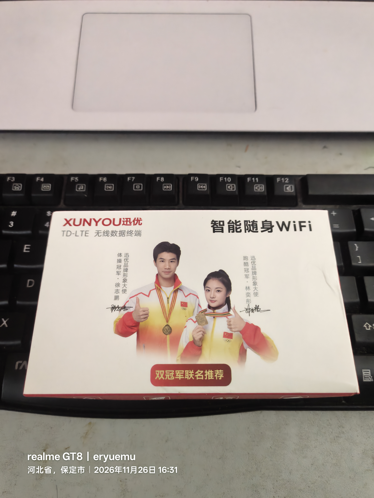
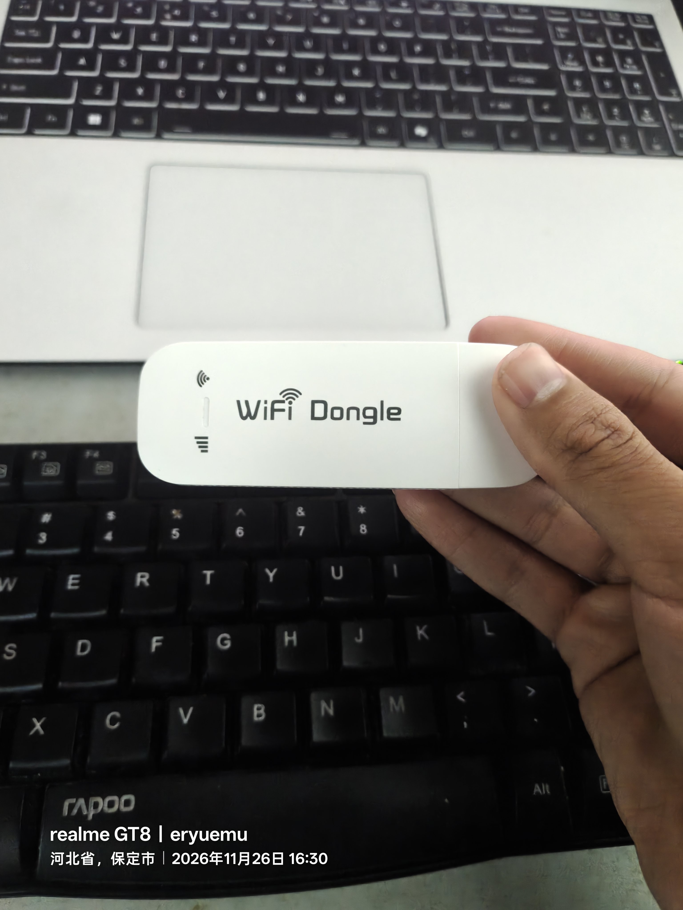
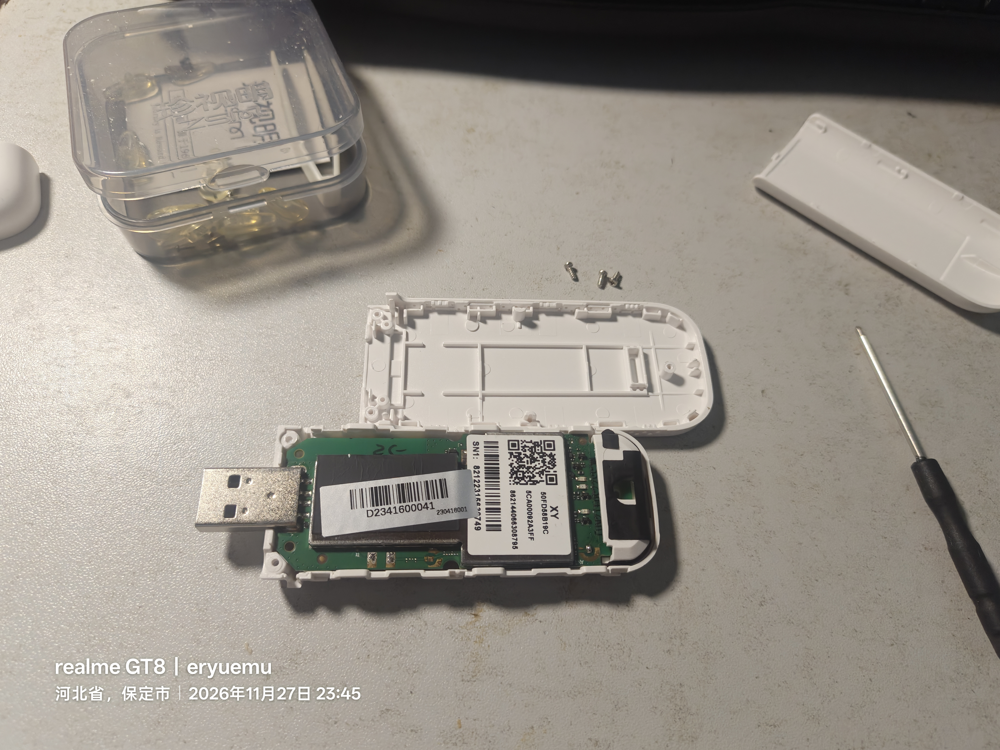
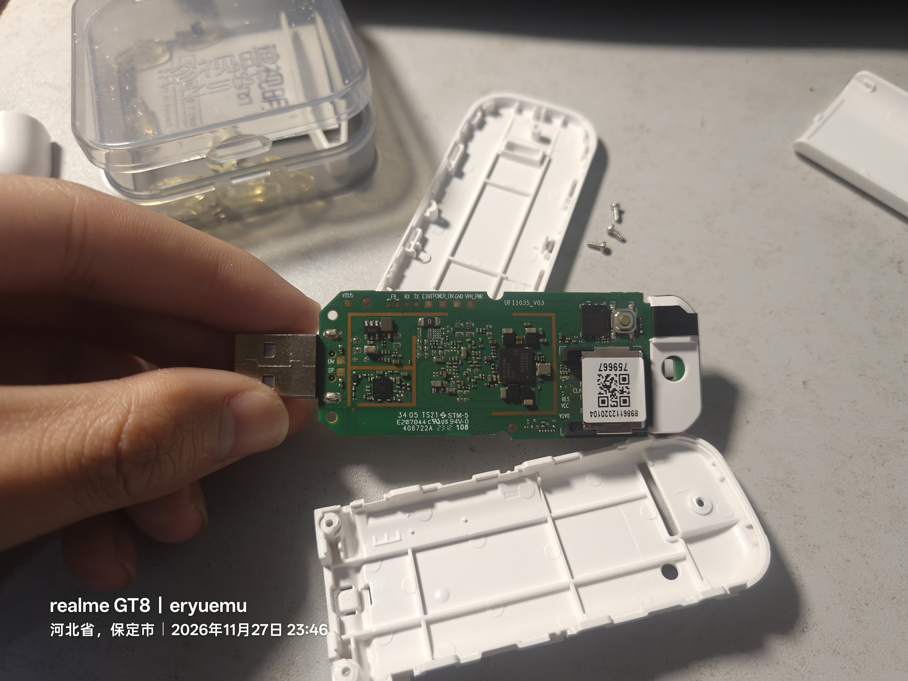
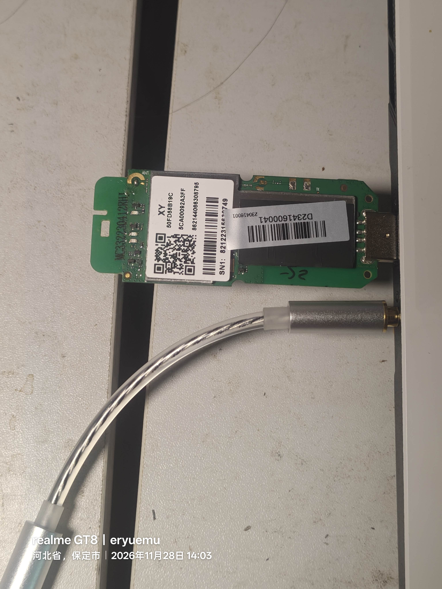

# 给21块钱的随身WiFi刷 Debian 12:最小最便宜的linux迷你电脑

> **核心背景**：花 21 块钱买了根 `XUNYOU迅优` 4G 随身 Wi-Fi，从出厂 Android `4.4.4`（`UFI103S_V02_XY_YKM_DE_230327`，基带 `UFI103_CT 20220801`，SK Hynix `H4G2a` `512 MB RAM + 4 GB eMMC`）刷成 `Debian GNU/Linux 12 (bookworm)`（内核 `6.4.0-rc4-jsbsbxjxh66-compile+` `aarch64`）。宿主机是双系统 Ubuntu（`/` `/dev/nvme0n1p4` `98G` 当时剩 `9.6G–13.4G`，同机配着 ESP32 规则 `/etc/udev/rules.d/99-esp32.rules`；隔壁 Windows `/dev/nvme0n1p3` `840G` 剩 `335G`）。
>
> **本文结构**：一、是什么 → 二、买来目的是什么、能做什么 → 三、怎么做（刷之前的准备与把关）→ 四、这个过程中怎么做的 → 五、最后刷完（验收、收尾与照抄清单）→ 六、过程中和刷完可能出现的问题（Q1–Q7）→ 七、命令速查 → 八、一句话总结。

## 💡 速览

| | 内容 |
| --- | --- |
| 是什么 | 21 块钱的 `UFI103S`（固件 `V02` / 主板丝印 `V03`），高通骁龙 410 `MSM8916`，`512 MB RAM + 4 GB eMMC` |
| 买来能做什么 | 最小最便宜的 64 位 ARM Linux 迷你主机：免屏幕插电即通 SSH（`192.168.68.1:22`），自带 Wi-Fi、4G 基带、`2.3G` 可用盘，可当便携 Linux 终端、轻量定时脚本机、4G CPE 或备用短信接收网关 |
| 怎么做（准备） | 核对原机 LBA、反汇编 `PhoneFeatures.odex` 保住 SIM 卡槽 GPIO、只拉黑 `qcserial` 保 ESP32、借 Windows 凑 `8.76 GiB` 空间 |
| 过程与最后刷完 | `adb` 抓 20 份快照 → 拆壳按 9008 备全盘 → `debugfs` 审计 `rootfs` → 9008 写回 `cmp` 通过 → 无卡测通基带锁实体卡槽 → 收尾留 `4.0G` 本地备份 |
| 可能出现的问题 | 9008 不亮灯正常；“8G”是双倍组包回读空间非下载体积；固定棒子 `linux-usb-gadget` MAC + 宿主机防抢网关/DNS，解决一插上就断网 |

---

## 一、是什么

### 1.1 外观、包装与拆壳后的真实硬件

这根东西是 21 块钱买来的贴牌 `XUNYOU迅优` 4G 随身 Wi-Fi：包装盒写着 `TD-LTE 无线数据终端 智能随身WiFi`，白色外壳印着 `WiFi Dongle`，左边留了 Wi-Fi 和 4G 信号灯窗口。





买这种便宜棒子前最关键的是先看芯片是不是正统高通——如果是 ASR 或中兴微芯片，基本没法上主线 Debian。插电脑先用免安装 `adb`（`~/workspace/tool/platform-tools/adb` `1.0.41 / 37.0.1`）做了一轮只读检测，USB 识别为 `05c6:9091`（串号 `34161130`），确认里面确实是 **高通骁龙 410（MSM8916）**。

拧开螺丝拆开塑料壳之后，正反两面长这样：





拆开之后直接对上了三件硬件事实：
1. **主板丝印比固件版本号高一小版**：Android `getprop` 写 `UFI103S_V02_XY_YKM_DE_230327`，主板背面绿油丝印实际刻着 **`UFI103S_V03`**。
2. **标签身份与机内一致**：屏蔽罩侧贴纸写着 `XY 50FD58B19C`、`5CA00092A3FF`、`862144066308795`、`SN1: 82122315630749`，和 `adb` 从 `AIUFi.log` 读出来的 MAC、IMEI、SN1 一字不差。
3. **9008 按钮藏在壳里**：SIM 卡槽右上角那颗白色轻触开关没有做外壳开孔，**必须拆壳才能按到**。

### 1.2 硬件规格前后对照

| 维度 | 原厂 Android 4.4.4 实测底子 | 刷完 Debian 12 后的硬件状态 |
| --- | --- | --- |
| SoC / 架构 | 高通 `MSM8916`（`soc_id=206`，4 核 Cortex-A53，32 位 `armv7l`） | 同颗 `MSM8916`，运行 64 位 `aarch64` |
| 系统与内核 | Android `4.4.4`（`KTU84P`），Linux `3.10.28` | `Debian GNU/Linux 12 (bookworm)`，`6.4.0-rc4-jsbsbxjxh66-compile+` |
| 内存与闪存 | `MemTotal: 402316 kB` + `192 MiB zram0`；SK Hynix `H4G2a` `4 GB eMMC`（`7,634,944` 扇区 = **`3,909,091,328` 字节**） | RAM `372 MB` + `swap 186 MB`；`/` `/dev/mmcblk0p14` 自动扩为 `3.3G`（已用 `879M`，可用 `2.3G`） |
| USB 与网络 | `05c6:9091`（Diag + Serial + `qmi_wwan` + ADB） | `18d1:d001`：USB RNDIS 网卡（`192.168.68.1/24`）+ SSH（22 端口）+ ADB（`0123456789`）+ `wlan0` 热点（`10.42.0.1/24`，SSID `WIFI`） |
| 基带与 SIM | `UFI103_CT 20220801`，默认启用内置电信 eSIM（`ESIM_SEL = on`） | 同基带，IMEI 保留 `862144066308795`，开机默认锁定**外插实体 SIM 卡槽（`sim:sel = 1`）** |

---

## 二、买来目的是什么、能做什么

### 2.1 买来目的是什么：最小最便宜的 64 位 Linux 迷你电脑

花 21 块钱买这根棒子，**不是为了把它当普通插卡上网棒用**，而是看中它极其离谱的性价比：
- 它把**四核 Cortex-A53（`MSM8916` `aarch64`）、512 MB 内存、4 GB 板载 eMMC（免买 SD 卡）、USB 供电+虚拟网卡、板载 Wi-Fi、外插 4G SIM 卡槽与基带**全塞进了 U 盘大小的一块小板子里；
- 相比动辄一两百元的树莓派 / 香橙派，还要另配供电、读卡器、TF 卡和无线模块，这东西插上任何一个 USB 口（电脑、充电头、充电宝、路由器 USB 口）就直接通电开机，是一台真正的“最小最便宜的 Linux 迷你电脑”。
- 原厂带的 Android 4.4.4 被厂商改得面目全非（只开放网页后台和受限应用，还内置了电信切卡管控），刷成纯正 `Debian 12` 之后，才能拿到完整 `root`、标准 `systemd`、`apt` 软件源和干净的 6.4 内核网络栈。

### 2.2 刷完之后具体能做什么（结合实机资源边界）

结合这次实机验证出来的接口与资源额度（RAM `372 MB` + `swap 186 MB`、根分区剩余 `2.3G`、USB RNDIS + `wlan0` + `/dev/wwan0qmi0`/`wwan0at0`），它适合跑和能做的事、以及做不了的事如下：

| 玩法方向 | 依赖的本机硬件 / 接口 | 适合做的具体事情与注意事项 |
| --- | --- | --- |
| 随身零外设 Linux 服务器 / 实验机 | USB 接口（插电脑 `192.168.68.1:22` SSH）或充电头供电连 `wlan0` | 跑轻量 Python/Go 脚本、内网定时任务、Git 私有同步、网络抓包/探针、学习 ARM64 Linux 与驱动调试 |
| 开源 4G Wi-Fi / USB 共享热点 | `ModemManager`（`wwan0`）+ `wlan0` AP + `usb0` RNDIS | 插入有效实体 SIM 卡即可做开源可控的 4G 随身路由或给台式机做 USB 备用网口（需注意 3.1 的切卡把关与 Q6 的网卡网关放行切换） |
| 轻量个人短信接收 / 通知网关 | `wwan0at0` AT 口 + `/dev/wwan0qmi0` + Wi-Fi 联网 | 配合实体 SIM 卡收发短信并走 Webhook 转发到电脑或手机（`POSTMORTEM.md` 实测中国移动短信正常，中国电信受 VoLTE/CS 影响未必能收短信） |
| **物理上限（做不了什么）** | `372 MB` 可用内存 + `2.3G` 磁盘 | 不适合跑桌面 GUI、浏览器、大型 Java/Node 编译或内存大户服务；2.3G 磁盘装轻量命令行套件绰绰有余，不宜往里塞大模型或海量镜像 |

---

## 三、怎么做（刷之前的准备与把关）

正式往 eMMC 写东西之前，我先定好两道原则：做好完整原厂备份、别把原有的“插卡功能”刷废。对应动手前先把三项准备工作做透。

### 3.1 准备一：核对 LBA 分区表，并反汇编把关 SIM 多路引脚

为什么很多随身 Wi-Fi 刷完 Debian 后卡槽会彻底失灵？刷之前我把原厂底层先查了两遍：

1. **LBA 分区扇区表 100% 对齐**：从运行态 `/sys/block/mmcblk0/mmcblk0p*/{uevent,start,size}` 导出的 `modem`（`131072–262143`）、`sbl1`（`262144–263167`）、`aboot`（`264192–266239`）、`modemst1`（`276480–279551`）、`modemst2`（`279552–282623`）、`fsc`（`284672–284673`）、`fsg`（`393280–396351`）、`boot`（`396384–429151`）、`persist`（`2067552–2133087`）起止扇区，与 `maomomo-eth/ufi103s-debian` 的 `assemble_emmc.py` 中 `STOCK_PARTITIONS` **逐扇区一致**。
2. **反汇编 `PhoneFeatures.odex` 与比对 DTB 设备树**：提取原机 `/system/app/PhoneFeatures.odex`（`SimDetector$SimSwitchThread.run()` 与 `CheckNullIccidThread.run()`，第 9130–9574 行）与 `/proc/device-tree/soc/gpio-leds`、`/sys/kernel/debug/gpio`，对照 `boot-debian12-6.4-ufix0x.img` 内嵌 DTB 得出 4 颗引脚真值表：

| MSM8916 GPIO | 原厂节点（出厂状态） | Debian 6.4 DTB 节点（默认状态） | 硬件角色 |
| --- | --- | --- | --- |
| `GPIO 0`（`gpio-902`） | `ESIM_SEL`（`on` / `out hi`） | `sim:sel2`（`off`） | 内置 eSIM 1 |
| `GPIO 1`（`gpio-903`） | `SIM_EN`（`off` / `out lo`） | `sim:en`（`off`） | 切卡使能脉冲脚（拉高 `500 ms` 后延时 `300 ms` 拉低） |
| `GPIO 2`（`gpio-904`） | `SIM_SEL`（`off` / `out lo`） | `sim:sel`（`on`） | **外插实体 SIM 卡槽** |
| `GPIO 3`（`gpio-905`） | `ESIM2_SEL`（`off` / `out lo`） | `sim:en2`（`off`） | 内置 eSIM 2 |

社区以前弄废插卡的坑（见 `tools/ufi103s-debian/docs/POSTMORTEM.md`）：旧版 `/usr/sbin/openstick-sim-changer.sh` 先把四路全关成 `0`，再用前缀匹配 `grep -e "^$1"` 找 `sim:sel`，结果同时命中 `sim:sel` 和 `sim:sel2`，换行路径报错退出导致**4 路引脚全停在 0（断卡）**。`v2.2.0` 已改为整行匹配 `grep -F -x -- "$1" | head -n 1`；同时 Linux 下基带用的是 `/lib/firmware/modem.*` 共 22 个文件（不是 Android 的 `modem.bin`），并且必须写回本机自己的 `fsc`/`fsg`/`modemst1`/`modemst2` 校准分区。

### 3.2 准备二：建立隔离工作区与 9008 驱动（避开误伤 ESP32）

把全部工具与备份隔离开在 `~/workspace/ufi103s-debian/`，不往 `~` 或 `/tmp` 乱放：
- 克隆 `maomomo-eth/ufi103s-debian` 与 `bkerler/edl`；
- 对 `bkerler/Loaders` 用 `sparse-checkout` 只拉 `qualcomm/` 目录下 MSM8916 Firehose loaders；
- 在工作区内建立 `tools/edl-venv` 和 `tools/edl-run` 包装脚本，安装隔离版 `uv 0.13.10`（`tools/uv-pkg/` + `tools/bin/uv`）和系统包 `ripgrep 15.1.0`；
- 下载解压 `release/ufi103s-debian-v2.2.0-base` 并确认 `SHA256SUMS` 8 项 `OK`。

宿主机配置 9008 权限时有个大坑：Ubuntu 内核见到 `05c6:9008` 会自动绑定 `qcserial` 生成 `/dev/ttyUSB0`，走串口跑 `edl` 在 Sahara 握手后会 `Timed out`。必须卸掉 `qcserial` 并配上 `51-edl.rules` 让 `edl` 走 `libusb`。同时因为我这台电脑还留着 ESP32 开发板的 `/etc/udev/rules.d/99-esp32.rules`，**不能照搬 `tools/edl/Drivers/blacklist-qcserial.conf`（它连带拉黑了 `cdc_acm`）**，只写入一行 `blacklist qcserial`：

```bash
sudo cp ~/workspace/ufi103s-debian/tools/edl/Drivers/51-edl.rules /etc/udev/rules.d/51-edl.rules
echo 'blacklist qcserial' | sudo tee /etc/modprobe.d/blacklist-qcserial.conf >/dev/null
sudo modprobe -r qcserial
sudo udevadm control --reload-rules && sudo udevadm trigger --subsystem-match=usb
```

### 3.3 准备三：核清 8.76 GiB 临时空间与选定 Debian 12

当时 Ubuntu 根分区 `/dev/nvme0n1p4` 做完原盘备份只剩 `9.6G`（`10,295,320,576` 字节）。虽然实际联网下载不到 `840 MiB`（`rootfs` `821.6 MiB` + 基础包 `17 MiB`），但 `flash-edl-full-emmc.sh`（第 164–166 行）为了“写入前组出整盘 + 写入后再整盘回读对比”，强行要求工作目录有 `9,403,629,568` 字节（`8.76 GiB`）空间。所以我借了双系统隔壁空余 `335G` 的 Windows NTFS 分区（`/dev/nvme0n1p3`）当临时组包舞台。

系统版本选择经过实机验证的 **Debian 12（Bookworm）**，不用更新的 Debian 13——`POSTMORTEM.md`（第 10–15 行）记载过作者测试 Debian 13 构建版冷启动后只亮红灯、USB 和 Wi-Fi 全部失联的翻车。

---

## 四、这个过程中怎么做的

### 4.1 第一步：用 `adb` 提取 20 份原厂运行态快照

在还没覆盖任何分区之前，先从原厂 Android 里用 `adb` 抢救性采集全套运行态证据到 `backup/android-live/`：包括 `build.prop`、`getprop.txt`、`partition-lba.txt`、`partition-table.txt`、`by-name.txt`、`dt-gpio-nodes.txt`、`debugfs-gpio.txt`、`AIUFi.log`、`WCNSS_cfg.dat`、`YunKeMao.apk`、`cpeweb.apk`、`PhoneFeatures.apk`/`odex` 及反汇编文本等共 **20 份文件**，全部过完 `sha256sum -c SHA256SUMS`（`OK`）。

### 4.2 第二步：拆壳按 9008 按钮，完成 4G 全盘与 19 分区物理备份

拔掉棒子拆开壳，按住卡槽右上角白色微动按键插入电脑 USB 口进 `05c6:9008`（9008 走芯片 Boot ROM，还没启动 LED 驱动，**完全不亮灯属于正常现象**）。配置完前节 `51-edl.rules` 与 `qcserial` 黑名单后，USB 节点变为 `crw-rw-rw-+`。随即执行 9008 全盘物理备份：

```bash
EDL=~/workspace/ufi103s-debian/tools/edl-run \
  ~/workspace/ufi103s-debian/tools/ufi103s-debian/scripts/backup-full-emmc.sh \
  ~/workspace/ufi103s-debian/backup/edl-raw/bak-862144066308795
```

输出文件落在 `bak-862144066308795/`：`3,909,091,328` 字节整盘镜像 `original-full-emmc.bin`，外加 `partitions/` 下 19 个独立分区镜像（含 `fsc.bin` `1024 B`、`fsg.bin` `1572864 B`、`modemst1.bin` `1572864 B`、`modemst2.bin` `1572864 B`、`persist.bin`、`modem.bin`、`aboot`/`sbl1`/`boot`）。

过程中遇到一个插曲：`gpt/` 子目录是空的。翻查 `tools/edl/edlclient/Library/firehose_client.py` 后发现上游源码注释掉了写 `gpt/*.bin` 的代码，而主备 GPT 头和 CRC 已完整包含在 `original-full-emmc.bin` 首尾扇区中；随后调用 `assemble_emmc.verify_stock()` `PASS`，22 项 `SHA256SUMS` 全部 `OK`。

### 4.3 第三步：挂载 Windows 盘离线组包，并用 `debugfs` 只读审计 `rootfs`

为了防止挂载到未完全关机的 Windows 分区写坏 NTFS，先执行 `mount -t ntfs3 -o ro /dev/nvme0n1p3 /mnt/win` 只读探路确认状态干净，再重新挂载为 `rw`；下载并校验 `rootfs-debian12-usb-wifi-ssh-vocat-mm-wifi.img`（`861,512,128` 字节，SHA-256 `65fa6962951cafd1fc38d886d6e8df714904b61c2443cdfb7c4e436f3c31e2d6`）到 `/mnt/win/ufi103s-work/`。

不直接写棒子，先加 `--prepare-only` 离线拼盘，再用 `/usr/sbin/debugfs` 只读打开 `rootfs.raw.img` 内部审计切卡脚本和基带固件：

```bash
export PATH="$HOME/workspace/ufi103s-debian/tools/bin:$PATH"
~/workspace/ufi103s-debian/tools/ufi103s-debian/scripts/flash-edl-full-emmc.sh \
  --backup-dir ~/workspace/ufi103s-debian/backup/edl-raw/bak-862144066308795 \
  --release-dir ~/workspace/ufi103s-debian/release/ufi103s-debian-v2.2.0-base \
  --rootfs-override /mnt/win/ufi103s-work/rootfs-debian12-usb-wifi-ssh-vocat-mm-wifi.img \
  --rootfs-sha256 65fa6962951cafd1fc38d886d6e8df714904b61c2443cdfb7c4e436f3c31e2d6 \
  --output-dir /mnt/win/ufi103s-work/prepare-862144066308795 \
  --prepare-only
```

审计结果三项全部通过：`debian-v2-full-emmc.bin` 校验为 `97cb12a91f01d01944ff73cd37c09fc4bd9e5fe7d3f515f91b501a02a94c3471`；`/usr/sbin/openstick-sim-changer.sh` 确已修复为 `grep -F -x -- "$1" | head -n 1`；`/lib/firmware` 内的 `mba.mbn` 与 `modem.*` 共 `22` 个文件齐备。

### 4.4 第四步：9008 全盘写入、回填校准并整盘回读 `cmp`

确认门禁无误后，带 `--yes --reset` 执行正式刷写（13:47 启动，14:02 完成）：

```bash
export PATH="$HOME/workspace/ufi103s-debian/tools/bin:$PATH"
export EDL="$HOME/workspace/ufi103s-debian/tools/edl-run"
~/workspace/ufi103s-debian/tools/ufi103s-debian/scripts/flash-edl-full-emmc.sh \
  --backup-dir ~/workspace/ufi103s-debian/backup/edl-raw/bak-862144066308795 \
  --release-dir ~/workspace/ufi103s-debian/release/ufi103s-debian-v2.2.0-base \
  --rootfs-override /mnt/win/ufi103s-work/rootfs-debian12-usb-wifi-ssh-vocat-mm-wifi.img \
  --rootfs-sha256 65fa6962951cafd1fc38d886d6e8df714904b61c2443cdfb7c4e436f3c31e2d6 \
  --output-dir /mnt/win/ufi103s-work/flash-862144066308795 \
  --yes --reset
```

脚本按序完成了：全盘覆盖写盘 → 单独回填并回读核验 `fsc`、`fsg`、`modemst1`、`modemst2` → 把 4G eMMC 整块读回为 `device-readback.bin` 与写入镜像逐字节 `cmp` 比对一致 → 发送 `EDL reset` 复位重启。

---

## 五、最后刷完

### 5.1 开机上线与成品实测

`14:02` 复位之后，裸板插在笔记本 USB 口上直接拉起了 Debian 12：



实机验收各项指标全部上线：
- **系统与空间**：`Debian GNU/Linux 12 (bookworm)`，内核 `6.4.0-rc4-jsbsbxjxh66-compile+`（`aarch64`）；`/` `/dev/mmcblk0p14` 自动扩展至 `3.3G`（已用 `879M`，可用 `2.3G`），内存 `372 MB` + `swap 186 MB`。
- **网络与接入**：USB 枚举为 `18d1:d001`，棒子端 `usb0` 为 `192.168.68.1/24`、SSH 22 端口连通，`wlan0`（`10.42.0.1/24`，SSID `WIFI`）和 ADB（`0123456789`）全部就绪。
- **基带枚举**：刚开机（14:02:57）首次查 `ufi103s-modem-test` 报了一次 `No modems were found`，等 `ModemManager 1.20.4` 跑完几十秒 QMI 探测后再次查询，`Modem/0` 出现并读出本机原 IMEI `862144066308795`。

### 5.2 无实体卡条件下验通 SIM / 基带并锁回实体卡槽

因为手头暂时没有实体 SIM 卡，直接切到**板载 eSIM（`sim:sel2`）**做了一次软件级硬件闭环测试，验证通过后再切回并锁定**外插实体 SIM 卡槽（`sim:sel`）**：

| 阶段 | 执行切换与 GPIO 亮度 | `qmicli --uim-get-card-status` | `mmcli -m any` | 实测意义 |
| --- | --- | --- | --- | --- |
| 1. 临时切板载 eSIM | `SIM_ENABLED=sim:sel2`；`sim:sel2 = 1`，其余三路 `0` | `Slot [1]` `Card state: 'present'`，`Application type: 'usim (2)'`，`Application state: 'ready'` | `equipment id: 862144066308795`、`state: searching`、`power state: on`、`SIM/0 (active: yes)` | 证明 MPSS 固件、`rmtfs`、校准分区、QMI 与 GPIO 切卡链路全部正常 |
| 2. 切回实体卡槽并锁定 | `SIM_ENABLED=sim:sel`；`sim:sel = 1`，其余三路 `0` | `no-atr-received (3)`（空槽预期） | `equipment id: 862144066308795`、`state: failed`、`failed reason: sim-missing` | 引脚恢复外插实体卡槽，与开机服务一致 |

### 5.3 清理临时垃圾与最终留存结果

验收完后清光了 Windows 盘下约 `9 GB` 的临时组包文件 `/mnt/win/ufi103s-work/`、`release/ufi103s-debian-v2.2.0-base.tar.gz`（`17M`）、`~/.cache/pip`、`~/.cache/uv`、`/var/cache/apt/archives/`、`__pycache__`、`/tmp/adb.1000.log` 与 `adb` 后台进程；接着先对工作区里的 `backup/android-live/`（20 项）与 `backup/edl-raw/bak-862144066308795/`（22 项）全部重跑 `sha256sum -c SHA256SUMS` 确认全部 `OK`，随后应“这边 Linux 够了”的要求删掉 Windows 盘下的 `/mnt/win/ufi103s-backup`，`sync` 后安全卸载并移除 `/mnt/win` 挂载点。

最终 Windows 盘零残留，Ubuntu `/` 剩余 **`9.7G`**，工作区 `~/workspace/ufi103s-debian/` 总计 **`4.0G`**（见 Q5 明细）。

### 5.4 从零照抄能用的实操清单

按顺序执行（**必须先备份核对 LBA 再写盘**）：

1. **原厂运行态取证与 LBA 核对**：通过 `adb` 导出 `/sys/block/mmcblk0/mmcblk0p*/{uevent,start,size}` 与 `/proc/device-tree/soc/gpio-leds`，确认总扇区 `7,634,944`（`3,909,091,328` 字节）且与 `STOCK_PARTITIONS` 一致。
2. **配好单黑名单进 9008**：仅拉黑 `qcserial` 保住 `cdc_acm`，配合 `51-edl.rules` 重载 `udev`，拆壳按住卡槽旁按钮上电进 `05c6:9008`。
3. **9008 全盘与分区备份**：执行 `backup-full-emmc.sh`，确认 22 项 `SHA256SUMS` 与 `verify_stock()` `PASS`。
4. **确保目标盘有 >= 9.4 GB 空间并离线审计**：跑 `flash-edl-full-emmc.sh --prepare-only`，用 `debugfs` 核查 `openstick-sim-changer.sh`（`grep -F -x`）与 22 个 MPSS 固件。
5. **写盘、回填校准并整盘 `cmp`**：带 `--yes --reset` 写盘与整盘回读校验后重启。
6. **无卡先测基带再锁实体卡槽**：用 `SIM_ENABLED=sim:sel2` 跑 `qmicli` 与 `mmcli`，再用 `SIM_ENABLED=sim:sel` 锁回实体卡槽，等十余秒确认 `Modem/0` 上线。
7. **防断网与清场**：固定棒子 RNDIS `host_addr`/`dev_addr` 并给宿主机设置不抢默认网关与 DNS（见 Q6），清掉临时工作目录与缓存并停掉 `adb` 守护进程，留好 `backup/`。

---

## 六、过程中和刷完可能出现的问题

### Q1 棒子进 9008 之后彻底不亮灯，是不是刷死了？

不是。`9008`（EDL / QDL mode）走高通出厂 Boot ROM，比 bootloader 和 Linux 内核都要早，LED 控制脚还没有被任何软件点亮。只要宿主机 `lsusb` 能看见 `05c6:9008` 且安装 `51-edl.rules` 后设备权限为 `crw-rw-rw-+`，就完全正常。

### Q2 只有 4G 的棒子为什么提示要 8G 多空间，为什么不刷最新的 Debian 13？

前面在 3.3 算过账：真正从网上下载的文件一共不到 `840 MiB`（`821.6 MiB` rootfs + `17 MiB` 基础包），并非下 8G 系统。`8.76 GiB`（`9,403,629,568` 字节）是同时放置 `1,000 MiB` 裸分区、`3.64 GiB` 写入盘与 `3.64 GiB` 全盘回读镜像的防变砖临时账单，刷完即可删掉。不选 Debian 13 是因为作者在 `POSTMORTEM.md` 里实测 Debian 13 构建版冷启动后只亮红灯、USB 和 Wi-Fi 都不工作，目前稳定基线是 Debian 12。

### Q3 切回 `sim:sel` 怎么刚等 8 秒也提示 `No modems were found`？

`openstick-sim-changer.sh` 切槽时会执行 `modprobe -r/modprobe qcom-q6v5-mss` 并重启 `rmtfs` 与 `ModemManager`。这批服务重启后重新走 QRTR 发现节点、生成 `/dev/wwan0qmi0` 与 `wwan0at0/at1` 大约要十余秒，刚切换完 8 秒就查询会刚好撞在枚举中途。**副作用要写清楚**：以后手工切换 SIM 槽或刚上电前十几秒见到 `No modems were found`，先看 `4080000.remoteproc: running` 是否成立、等几秒复测即可，别误判成基带坏了。

### Q4 手头没有实体 SIM 卡，软件层面到底测出了什么、哪块还没测到？

同一次实机测试取回三组信号核对清楚：

| 验证目标 | 正向对照（代码路径确实跑了） | 负向 / 边界控制 | 未覆盖部分（客观留白） |
| --- | --- | --- | --- |
| SIM GPIO 切卡可控 | 切 `sim:sel2` 时 `sim:sel2 = 1`；切回 `sim:sel` 后 `sim:sel = 1` 且其余三路为 `0` | 切换中另一路被立即清 `0`，未触发旧脚本全关 bug | — |
| MPSS 基带与 QMI 读卡通路 | `sim:sel2` 下 `qmicli` 读出 `present` / `usim (2)` `ready`，`mmcli` 识别 IMEI `862144066308795`、`SIM/0 active: yes` | 切回空槽 `sim:sel` 后立即跌回 `sim-missing` / `no-atr-received`，说明不是伪造缓存结果 | 外插物理卡座弹片氧化/虚焊或实体卡入网拨号未实测（需插卡后再测） |

### Q5 收尾后宿主机和棒子里分别装好了什么、`workspace` 多了多大？

棒子内现在运行 Debian 12（`6.4.0-rc4` `aarch64`）、`/` 占 `879M`（余 `2.3G`）、USB RNDIS `192.168.68.1:22` SSH、Wi-Fi `wlan0` 热点（`10.42.0.1/24`）及 ADB（`0123456789`），开机默认已锁定 `sim:sel`。宿主机系统层另装有 `ripgrep 15.1.0` 与 `/etc/udev/rules.d/51-edl.rules`、`/etc/modprobe.d/blacklist-qcserial.conf`。

`workspace` 下只新增一个 `~/workspace/ufi103s-debian/` 目录，实测 **`4.0G`**（其中 95% 以上都是原厂备份，工具和引导包仅 `144M`）：

| 目录 / 文件 | 实测大小 | 作用说明 |
| --- | --- | --- |
| `backup/edl-raw/bak-862144066308795/` | `3.8G` | 整盘原厂镜像 `original-full-emmc.bin`（`3.7G`）+ 19 个独立分区镜像 + `SHA256SUMS` |
| `backup/android-live/` | `45M` | 原厂运行态快照、`PhoneFeatures` 反汇编与设备树记录 |
| `tools/` | `125M` | `edl`（`87M`）、独立 `uv-pkg`（`38M`）、`edl-venv`（`948K`）、`ufi103s-debian`（`480K`） |
| `release/` | `19M` | `ufi103s-debian-v2.2.0-base` 引导包（已删 `17M` `.tar.gz` 压缩包） |
| `README.md` | `8.0K` | 硬件核验、GPIO 对照、刷机、防断网与清理全记录 |

### Q6 为什么棒子一插上电脑就断网了？只改宿主机为什么重启还会复发，最后怎么彻底改好的？

这是这轮最容易踩、而且**“只改宿主机还治标不治本”**的一个坑。

**1. 一插上就断网的直接原因**
棒子内部 `usb0` 配了 `NetworkManager` `shared` 模式（`192.168.68.1/24`），宿主机插上 USB RNDIS 网卡后，会通过 DHCP 拿到 IP、默认网关和 DNS。Ubuntu 桌面给有线以太网分配的路由跃点远低于无线网卡（宿主机 `wlp3s0` 默认路由 metric 为 `20600`），于是系统把全局默认出口和 DNS 一起切去了当时并没有 SIM 卡流量的 `192.168.68.1`，电脑当场断网。

**2. 核查此前“只改宿主机”发现的三处隐患（实际只改了一半）**
之前让另一个助手对宿主机做了配置，但把棒子接回来实机核查 Netplan（`/etc/netplan/90-NM-*.yaml`）与系统服务后，发现了三个问题：
- `有线连接 1`（`enx46275ffdee5e`，写入时间 `2026-08-28 23:28:04`）其实是更早以前的旧网卡，当前这根棒子对应的是 `有线连接 2`（`enx1e85c0871748`）；
- 当时把 `有线连接 2` 设成了 `autoconnect = false`，插上并未真正激活测试，而且配置里只有 `ipv4.never-default` / `ipv4.ignore-auto-dns`，没有把 IPv6 也加上隔离；
- **最核心的漏网在棒子端**：查看棒子 `/usr/sbin/linux-usb-gadget`，它调 `gc -a rndis` 创建 ConfigFS gadget 时根本没有写入 `host_addr` 和 `dev_addr`。实测刷完第一次开机时宿主机看到的是 `enxc64d3af71401`，重启后变成了 `enx1e85c0871748`——这意味着**如果不改棒子端，下次只要把棒子断电重插一次，它又会随机冒出一个新 MAC，Ubuntu 立刻新建 `有线连接 3` 重新抢走网关并断网**。

**3. 双端彻底修法与重启实测**
把棒子端与宿主机端两边一起补全（笔记本原生有线口 `netplan-enp2s0` 保持未动）：

| 端侧 / 对象 | 位置 / 接口 | 最终配置 |
| --- | --- | --- |
| 棒子端 USB Gadget | `/usr/sbin/linux-usb-gadget` | 在 `gc -a rndis` 与 `gc -e` 之间固定写入 `host_addr=1e:85:c0:87:17:48`、`dev_addr=6a:69:1b:1b:3a:ed` |
| 宿主机 `有线连接 1` | `enx46275ffdee5e` | `autoconnect=yes`，`ipv4/ipv6.never-default=yes`，`ipv4/ipv6.ignore-auto-dns=yes` |
| 宿主机 `有线连接 2`（本棒子） | `enx1e85c0871748` | `autoconnect=yes`，`ipv4/ipv6.never-default=yes`，`ipv4/ipv6.ignore-auto-dns=yes` |

改完直接执行 `reboot` 重启棒子做插拔级实测：
- **不新建连接**：`enx1e85c0871748` 自动复原，MAC 固定为 `1e:85:c0:87:17:48`，`有线连接 2` 自动激活拿到 `192.168.68.76/24`（无 `有线连接 3`）；
- **不断外网与 DNS**：`ip route` 默认出口留在 `default via 192.168.1.1 dev wlp3s0 proto dhcp src 192.168.1.5 metric 20600`，`192.168.68.0/24` 仅走直连子网路由；`resolvectl status` 中 `wlp3s0` 为 `Default Route: yes`，`enx1e85c0871748` 为 `Default Route: no`；绕开本机代理直连 `curl -fsSIL --max-time 5 https://www.baidu.com` 返回 `HTTP/1.1 200 OK`；
- **SSH 照通**：`ping 192.168.68.1` 平均延迟 `0.772 ms`（0% 丢包），`192.168.68.1:22` 自动连通。

**副作用要写清楚**：以后一旦插上真实 SIM 卡、而且**确实想让电脑通过 USB 共享走棒子的 4G 流量上网**，必须把 `有线连接 2` 的 `ipv4.never-default` 改回 `no`（按需放开 DNS），否则电脑只会把它当纯内网 SSH 网卡使用，不会将外网流量转进去；如果想恢复成平时插着不自动连、用前手动开关，改 `autoconnect no` 再用 `nmcli device connect/disconnect enx1e85c0871748` 即可。

### Q7 以后插真实 SIM 卡上网还有哪些常见踩坑？

- **断电插卡再上电**：手机 SIM 卡座不支持热插拔，务必先拔棒子、装好卡再供电。
- **不要抢占端口与重复拨号**：不要在 `NetworkManager` 自动拨号期间反复手工运行 `nmcli connection up modem`，也不要让 VoCat 与 `ModemManager` 同时读写 `/dev/wwan0qmi0` / `/dev/wwan0at0`。
- **初次登录改密码**：USB SSH 和 `wlan0` 热点均采用镜像默认凭据，连上后先修改账户与热点密码。

---

## 七、命令速查

```bash
# 1. 仅拉黑 qcserial（保留 cdc_acm 防影响 ESP32 开发板）并重载 USB 9008 规则
sudo cp ~/workspace/ufi103s-debian/tools/edl/Drivers/51-edl.rules /etc/udev/rules.d/51-edl.rules
echo 'blacklist qcserial' | sudo tee /etc/modprobe.d/blacklist-qcserial.conf >/dev/null
sudo modprobe -r qcserial
sudo udevadm control --reload-rules && sudo udevadm trigger --subsystem-match=usb

# 2. 9008 全盘物理备份与校验
EDL=~/workspace/ufi103s-debian/tools/edl-run \
  ~/workspace/ufi103s-debian/tools/ufi103s-debian/scripts/backup-full-emmc.sh \
  ~/workspace/ufi103s-debian/backup/edl-raw/bak-862144066308795

# 3. 无修改只读审计 Debian rootfs 内部切卡脚本与 MPSS 固件数量
/usr/sbin/debugfs -R "cat /usr/sbin/openstick-sim-changer.sh" rootfs.raw.img
/usr/sbin/debugfs -R "ls -l /lib/firmware" rootfs.raw.img | grep -E "mba\.mbn|modem\." | wc -l

# 4. 棒子内：板载 eSIM 与实体卡槽切换 + UIM/基带检查（切换后等十余秒再查 ModemManager）
SIM_ENABLED=sim:sel2 /usr/sbin/openstick-sim-changer.sh
qmicli -d /dev/wwan0qmi0 -p --uim-get-card-status
SIM_ENABLED=sim:sel /usr/sbin/openstick-sim-changer.sh
ufi103s-modem-test && mmcli -m any

# 5. 棒子内固定 RNDIS host_addr/dev_addr（写入 /usr/sbin/linux-usb-gadget 中 gc -a rndis 与 gc -e 之间）
for f in "$CONFIGFS"/functions/rndis.*; do
    if [ -d "$f" ]; then
        echo "1e:85:c0:87:17:48" > "$f/host_addr"
        echo "6a:69:1b:1b:3a:ed" > "$f/dev_addr"
    fi
done

# 6. 宿主机设置 USB 网卡不抢默认网关/DNS（若要改手动可把 autoconnect 设为 no）
nmcli connection modify "有线连接 2" connection.autoconnect yes ipv4.never-default yes ipv4.ignore-auto-dns yes ipv6.never-default yes ipv6.ignore-auto-dns yes
nmcli device connect enx1e85c0871748
nmcli device disconnect enx1e85c0871748

# 7. 复验本地原厂备份校验和
(cd ~/workspace/ufi103s-debian/backup/android-live && sha256sum -c SHA256SUMS)
(cd ~/workspace/ufi103s-debian/backup/edl-raw/bak-862144066308795 && sha256sum -c SHA256SUMS)
```

---

## 八、一句话总结

花 21 块钱买到真高通 `MSM8916` 的 `UFI103S` 之后，看清它能当极简 Linux 迷你主机的定位与边界，走完“查清 LBA 与 SIM GPIO → 保驱动与借空间准备 → 9008 备份、审计与回读 `cmp` → 切板载 eSIM 验通基带锁实体卡槽 → 固定 RNDIS MAC 并隔离网关 DNS 防断网”，就能稳稳交付一台最小最便宜的 Debian 12 迷你主机。
